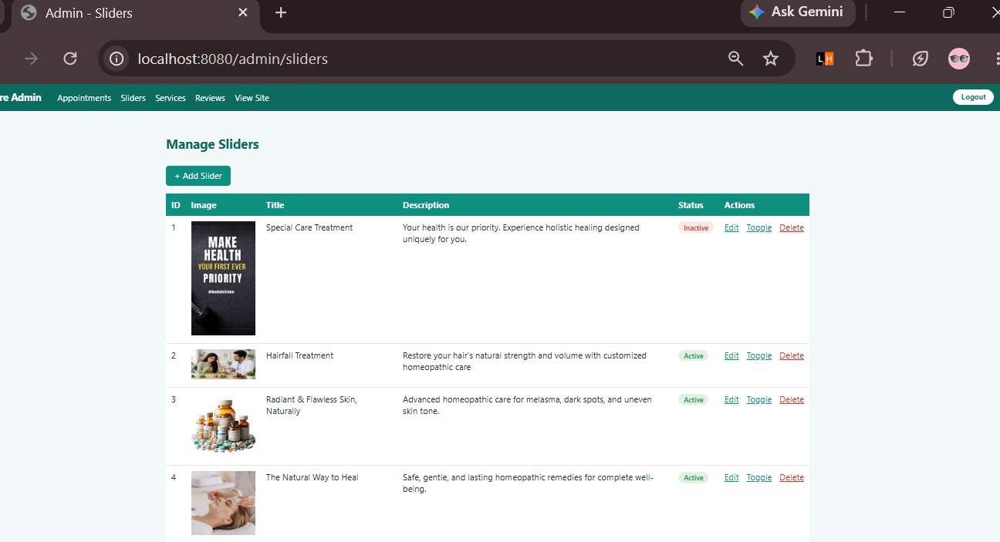
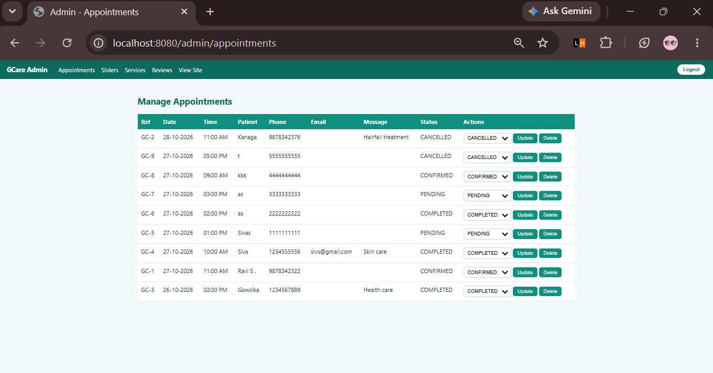
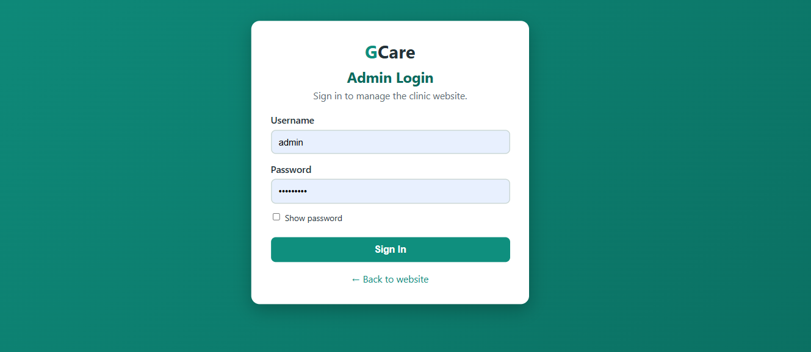
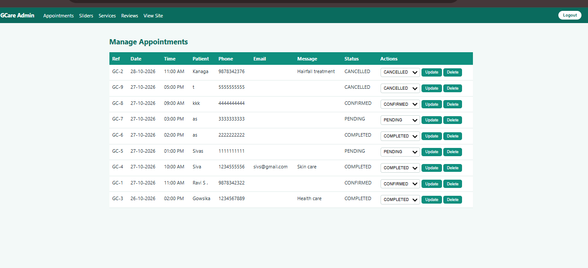

# GCare – Homeopathy Clinic Website

A full-stack clinic website built with **Spring Boot**. It is a rebuild of an earlier PHP/CodeIgniter project, with an admin panel, online appointment booking, and appointment tracking.


## Features

**For patients**
- Home page with banner sliders, services, and patient reviews, all loaded from MySQL
- Online appointment booking with validation
    - Clinic closed on Sundays
    - One patient per time slot, and a maximum of 10 bookings per day
    - A cancelled booking frees its slot
- Appointment tracking by reference number and phone number. The status changes from *Requested* to *Confirmed Successfully* once the clinic confirms it.

**For the clinic (admin panel)**
- Secure login with Spring Security and BCrypt-hashed passwords
- Create, edit, activate or deactivate, and delete sliders, services, and reviews
- Image upload with file type checking
- Appointment management with status updates (Pending, Confirmed, Completed, Cancelled)

## Tech Stack

| Layer | Technology |
|---|---|
| Language | Java 17 |
| Framework | Spring Boot (Spring MVC, Spring Data JPA, Spring Security) |
| View | Thymeleaf, HTML, CSS, JavaScript |
| Database | MySQL 8 |
| Build tool | Maven |

## Screenshots

| Booking                                        | Tracking |
|------------------------------------------------|---|
|  |  |

| Admin login | Admin appointments |
|---|---|
|  |  |

## Architecture

```
Browser -> Controller -> Service -> Repository -> MySQL
                |
            Thymeleaf template (HTML)
```

```
src/main/java/com/gcare
├── config        Security rules, upload mapping, admin seeder
├── controller    Public pages and admin/ controllers
├── entity        JPA entities (Review, Slider, ServiceItem, Appointment, AdminUser)
├── repository    Spring Data JPA repositories
└── service       Business logic, file storage, user loading
```

## Security

- Passwords are stored as BCrypt hashes, never as plain text
- `/admin/**` requires the role `ADMIN`
- All data-changing actions (save, toggle, delete, status update) use POST with CSRF protection
- Uploaded files are checked by extension and saved under generated names
- Secrets are read from environment variables, not from the code

## Getting Started

**Prerequisites:** JDK 17, MySQL 8, Maven (or use the included `mvnw`)

1. **Clone the project**
   ```
   git clone https://github.com/Abirami-2408/GcareHomoepathy.git
   cd REPOSITORY_NAME
   ```

2. **Create the database** by running `database/schema.sql` in MySQL Workbench or:
   ```
   mysql -u root -p < database/schema.sql
   ```

3. **Set the environment variables**

   | Variable | Meaning | Default |
      |---|---|---|
   | `DB_PASSWORD` | MySQL password | none (required) |
   | `DB_USERNAME` | MySQL user | `root` |
   | `DB_URL` | JDBC URL | `jdbc:mysql://localhost:3306/gcare` |
   | `ADMIN_USERNAME` | First admin login | `admin` |
   | `ADMIN_PASSWORD` | First admin password | none (required for the first run) |
   | `UPLOAD_DIR` | Folder for uploaded images | `uploads` |

4. **Run the application**
   ```
   ./mvnw spring-boot:run
   ```
   On Windows PowerShell, use `.\mvnw spring-boot:run`.

5. **Open** `http://localhost:8080` for the website and `http://localhost:8080/login` for the admin panel.

The first admin account is created automatically at startup from `ADMIN_USERNAME` and `ADMIN_PASSWORD`.

## Future Improvements

- Email or SMS notification when an appointment is confirmed
- Cloud storage for uploaded images
- Pagination and search in the admin lists
- A "change password" page for the admin
- Automated tests and a CI pipeline

## Author

**Abirami R K** – [GitHub](https://github.com/Abirami-2408)